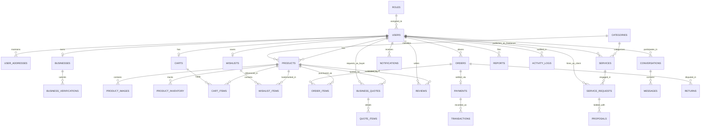

# ENTITY-RELATIONSHIP (ER) DIAGRAM
**Project Title:** MultiMart Multi-Model Database Architecture  

---

---

## Relationship Cardinalities
1. **One-to-Many (`1 : N`):**
   - `roles` to `users`: One role can be held by multiple users.
   - `categories` to `products`: One category contains many products across models.
   - `products` to `product_images`: One product holds multiple images.
   - `orders` to `order_items`: One order contains multiple line items.
   - `conversations` to `messages`: One conversation thread holds multiple messages.
2. **One-to-One (`1 : 1`):**
   - `users` to `businesses`: A registered business seller owns one corporate profile.
   - `users` to `carts`: A user possesses one active shopping cart instance.
   - `orders` to `payments`: An order is settled via a primary simulated payment transaction.
