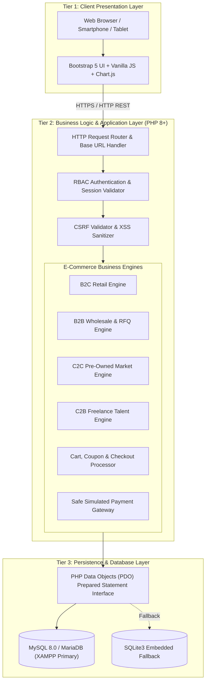

# SYSTEM ARCHITECTURE SPECIFICATION
**Project Title:** MultiMart: All-in-One Multi-Model E-Commerce Marketplace  

---

## 1. High-Level Architectural Model
MultiMart is engineered as a robust **3-Tier Distributed Architecture** featuring a clean separation of concerns:

---

## 2. Architectural Layers

### Tier 1: Client Presentation Layer
- **Responsive Layout:** Responsive grid adapting dynamically to smartphones, tablets, and desktops.
- **Asynchronous AJAX Interactivity:**
  - Live search suggestions with debounce to optimize server load.
  - Asynchronous add-to-cart operations updating cart badge counters without page reloads.
  - Interactive Chart.js graphs displaying revenue distribution across models.

### Tier 2: Application / Business Logic Layer (PHP 8+)
- **Security Interceptor:** Validates session credentials, role permissions, and CSRF nonces before processing requests.
- **Modular Engines:**
  - `B2C Engine`: Catalogs, search, product reviews, cart management.
  - `B2B Engine`: Wholesale master cartons, Minimum Order Quantities (MOQ), and RFQ negotiations.
  - `C2C Engine`: Consumer listings, condition grading, and localized pickup tags.
  - `C2B Engine`: Freelancer profiles, 3-tier engagement packages, and contract milestones.
  - `Simulated Payment Gateway`: Processes simulated UPI, Card, Net Banking, and COD authorizations.

### Tier 3: Persistence Layer (Data Store)
- **Universal PDO Abstraction:** Ensures transparent SQL execution across both MySQL and SQLite.
- **Strict 3NF Normalization:** 30 tables with strict foreign key constraints, cascading deletions, and audit trails.
