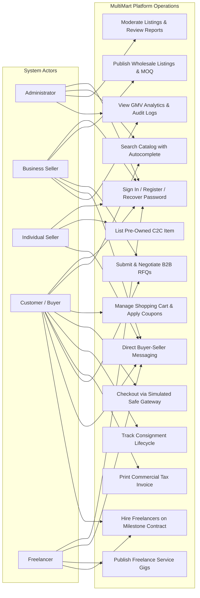

# USE CASE SPECIFICATION & DIAGRAMS
**Project Title:** MultiMart: All-in-One Multi-Model E-Commerce Marketplace  

---

## 1. Unified System Use Case Diagram

---

## 2. Actor Functional Responsibilities

| Actor | Access Scope & Primary Operations |
| :--- | :--- |
| **Customer** | Browse B2C retail goods, manage cart, apply coupons, simulate payment, track orders, message sellers, submit B2B RFQs, hire freelancers. |
| **Business Seller** | Manage corporate profile, list wholesale items with MOQ, manage warehouse inventory, respond to customer orders, submit RFQ bids. |
| **Individual Seller** | List pre-owned merchandise with condition ratings, set asking prices, communicate with local buyers, mark items sold out. |
| **Freelancer** | Publish service offerings with 3-tier packages, manage incoming project contracts, deliver project milestones, receive ratings. |
| **Administrator** | Master oversight, user role modifications, catalog approvals, order dispatch overrides, dispute resolution, review audit logs. |
